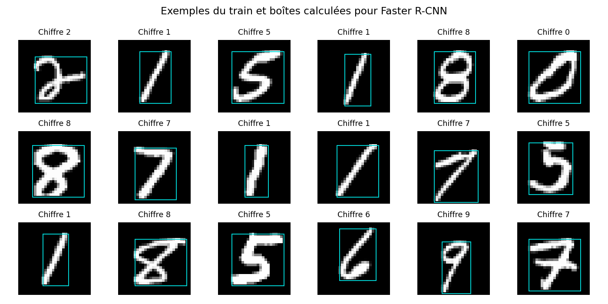

# Atelier 2 — Vision par ordinateur avec PyTorch

**Réalisé par KARMAS Hammam**

Le projet reconnaît les chiffres manuscrits **0 à 9 de MNIST** avec cinq approches :
CNN, Faster R-CNN, VGG16, AlexNet et Vision Transformer (ViT).
Les notebooks et le code sont commentés en français.

> **État des résultats :** les cinq modèles ont été exécutés ici en **vérification
> CPU**, sur 64 images de train, 40 de validation et 80 de test, pendant une époque.
> Leurs sorties réelles sont enregistrées. **Aucun entraînement complet GPU n'a été
> exécuté dans cet environnement, qui ne possède pas de GPU.** Les notebooks sont
> préparés pour lancer ce travail sur Colab. Les scores CPU ne sont pas les résultats
> finaux de l'atelier et ne permettent pas de classer les architectures.

## 1. Ouvrir les notebooks

| Partie | Contenu | Ouvrir dans Colab |
| --- | --- | --- |
| [Partie 1](notebooks/01_cnn_detection_transfert.ipynb) | Données, CNN, Faster R-CNN, VGG16 et AlexNet | [Lancer](https://colab.research.google.com/github/KarmasHammam/Atelier2_DeepLearning/blob/main/notebooks/01_cnn_detection_transfert.ipynb) |
| [Partie 2](notebooks/02_vit_comparaison.ipynb) | ViT depuis zéro, comparaison des cinq modèles et export | [Lancer](https://colab.research.google.com/github/KarmasHammam/Atelier2_DeepLearning/blob/main/notebooks/02_vit_comparaison.ipynb) |

Les sorties déjà visibles sur GitHub sont celles du profil CPU **smoke**.
La présence de sorties ne signifie donc pas que le GPU a été utilisé.

### Produire les vrais résultats GPU dans Colab

1. Ouvrir un notebook avec le lien ci-dessus.
2. Choisir **Exécution → Modifier le type d'exécution → GPU**.
3. Lancer **Tout exécuter**. La cellule initiale affiche le matériel et choisit
   automatiquement `full` si CUDA est disponible, sinon `smoke` avec un avertissement.
4. La partie 1 entraîne les quatre premiers modèles. La partie 2 entraîne le ViT
   et complète les autres modèles s'ils ne sont pas déjà terminés dans cette session.
5. La dernière cellule de la partie 2 télécharge une archive des résultats.
6. Dans Colab, utiliser **Fichier → Enregistrer une copie dans GitHub**, en conservant
   les sorties. Ajouter aussi les fichiers `results/full/` de l'archive au dépôt.

Le tableau des résultats complets est généré dans `results/full/README.md` seulement
quand les cinq modèles ont terminé. Un changement de session Colab peut effacer
les résultats non téléchargés : conserver l'archive avant de quitter la session.
Le code a été exécuté sur CPU ; le chemin CUDA et l'interface Colab restent à valider
sur une machine équipée d'un GPU.

## 2. Les données et la question posée

Source indiquée par le sujet : [MNIST sur Kaggle](https://www.kaggle.com/datasets/hojjatk/mnist-dataset).
Le téléchargement utilise les **fichiers IDX MNIST standard**, distribués par le
[miroir public fgnt/mnist](https://github.com/fgnt/mnist). Les empreintes MD5 de
référence de torchvision sont vérifiées et conservées. Aucune clé Kaggle n'est nécessaire.
Nous n'avons pas comparé octet par octet ces fichiers aux archives Kaggle.

MNIST contient 60 000 images de train et 10 000 de test. Chaque image mesure
28 × 28 pixels, avec un canal de gris et un chiffre comme étiquette.
Le fichier de train est séparé de manière stratifiée, avec la graine **42** :

| Profil | Train | Validation | Test officiel | Usage |
| --- | ---: | ---: | ---: | --- |
| `full` | 54 000 | 6 000 | 10 000 | Expérience GPU demandée par le sujet |
| `smoke` | 64 | 40 | 80 | Vérification fonctionnelle CPU, une époque |

Les cinq modèles partagent exactement les mêmes indices dans chaque profil.
Les empreintes de ces partitions sont enregistrées et vérifiées avant comparaison.
Le test n'intervient pas dans la sélection des poids.

L'exploration présente les effectifs par chiffre, des exemples et les boîtes créées
pour la détection. Elle contrôle aussi les dimensions, les valeurs des pixels et
les images vides. Les données brutes sont exclues de Git.



## 3. Préparation des images

| Modèles | Préparation |
| --- | --- |
| CNN et ViT | 1 × 28 × 28, conversion en tenseur, normalisation MNIST (0,1307 ; 0,3081) |
| VGG16 et AlexNet | 3 × 224 × 224, gris répété sur trois canaux, normalisation ImageNet |
| Faster R-CNN | Trois canaux, pixels dans [0,1] ; normalisation et taille 64 × 64 gérées par le détecteur |

Les constantes MNIST/ImageNet sont fixées ; aucune statistique n'est estimée sur le test.
Dans le profil complet, le train reçoit des rotations jusqu'à 10° et des translations
jusqu'à 5 %. Validation, test et sonde de train ne sont pas augmentés.
Pour Faster R-CNN, les boîtes sont recalculées après la transformation géométrique.

## 4. Les cinq architectures

### CNN : apprendre des motifs locaux

Deux blocs convolution 3 × 3, ReLU et max-pooling 2 × 2 réduisent l'image de
28 à 14 puis 7 pixels. Les convolutions utilisent stride 1 et padding 1.
Une tête entièrement connectée transforme les caractéristiques en dix logits :

```text
Image 1×28×28 → Conv(1,32) → ReLU → Pool
             → Conv(32,64) → ReLU → Pool
             → Flatten → Linear(3136,128) → ReLU → Dropout(0,25)
             → Linear(128,10)
```

Le modèle apprend depuis zéro, avec une loss d'entropie croisée.

### Faster R-CNN : adapter un détecteur à une classification

Faster R-CNN utilise un backbone ResNet50/FPN et des poids **COCO officiels**.
Le RPN propose des régions, puis une tête RoI prédit leurs classes et leurs boîtes.
La tête finale est remplacée par **11 classes : fond + dix chiffres**.
Les ancres sont réduites pour les petits objets.

MNIST ne fournit pas de boîtes. Nous créons une boîte entourant les pixels non nuls
avec des coordonnées `xyxy`. Le chiffre 0 devient la classe de détection 1 ;
le fond conserve l'indice 0. Ces boîtes sont une adaptation du jeu, pas des annotations
manuelles d'un véritable jeu de détection multi-objets.

Pour calculer accuracy et F1 **par image**, nous retenons la détection la plus
confiante. Aucune détection produit `-1` et compte comme une erreur. La boîte vraie
n'est jamais fournie au modèle pendant la prédiction. Nous calculons aussi :

- le taux d'absence de détection ;
- l'IoU moyenne, en comptant zéro lorsqu'il n'y a pas de détection ;
- la proportion « chiffre correct **et** IoU ≥ 0,5 ».

Ces indicateurs ne constituent pas une mAP. La loss du détecteur additionne plusieurs
termes (classification, régression de boîtes, objectness et RPN) ; **sa valeur ne doit
pas être comparée directement à l'entropie croisée des autres modèles**.
Pour calculer cette loss diagnostique en validation/test, les BatchNorm restent
figées et l'état aléatoire est restauré. Les prédictions sont faites en mode évaluation.

### VGG16 et AlexNet : fine-tuning partiel

Les poids **ImageNet officiels** servent de point de départ. La dernière couche
est remplacée par dix sorties. Le dernier bloc convolutif et la nouvelle tête sont
entraînés ; le reste des poids est figé. Il s'agit donc d'un fine-tuning partiel.
Les Dropout d'origine restent actifs pendant l'entraînement, puis sont désactivés
à l'évaluation. Si les poids ne sont pas accessibles, le programme échoue explicitement ;
il ne remplace pas silencieusement le préentraînement par des poids aléatoires.

Ces modèles disposent d'une connaissance préalable, contrairement au CNN et au ViT.
Cette différence, tout comme le préentraînement COCO de Faster R-CNN, doit être prise
en compte dans l'interprétation.

### ViT : apprendre des relations entre patches

Le ViT est construit depuis zéro dans [src/models.py](src/models.py) :

1. Découper l'image en **16 patches de 7 × 7** avec `Unfold`.
2. Projeter les 49 pixels de chaque patch vers 64 dimensions.
3. Ajouter un token **CLS** et des positions apprises : 17 tokens au total.
4. Appliquer trois blocs encodeurs : LayerNorm, attention à quatre têtes,
   connexion résiduelle et MLP avec GELU et Dropout.
5. Classifier le token CLS avec une tête à dix logits.

L'attention `softmax(QKᵀ / √d) V` est implémentée explicitement. Aucun ViT préentraîné,
`timm` ou encodeur Transformer tout fait n'est utilisé.
Le [tutoriel cité dans le sujet](https://medium.com/mlearning-ai/vision-transformers-from-scratch-pytorch-a-step-by-step-guide-96c3313c2e0c)
sert de référence pédagogique ; le code local constitue une implémentation autonome.

## 5. Réglages de l'expérience complète

| Modèle | Époques max. | Lot | Optimiseur | Taux initial | Weight decay |
| --- | ---: | ---: | --- | ---: | ---: |
| CNN | 8 | 64 | AdamW | 0,001 | 0,0001 |
| Faster R-CNN | 3 | 8 | SGD, momentum 0,9 | 0,005 | 0,0001 |
| VGG16 | 3 | 32 | AdamW | 0,0001 | 0,0001 |
| AlexNet | 3 | 64 | AdamW | 0,0001 | 0,0001 |
| ViT | 12 | 128 | AdamW | 0,0003 | 0,01 |

Ces réglages sont des choix initiaux explicites, **pas les résultats d'une recherche
exhaustive**. L'énoncé ne demande pas GridSearch pour cet atelier.
Le meilleur checkpoint est choisi selon le **F1 macro de validation**. Le test est
évalué ensuite. Les poids volumineux sont conservés localement dans `checkpoints/`,
qui est exclu de Git.

Les courbes présentent la loss sur tous les lots train et sur validation.
L'accuracy train est mesurée sur une sonde fixe de 1 000 images (`full`) ou
40 images (`smoke`), afin de limiter le coût de l'évaluation. Elle est nommée
`train_accuracy_probe` pour ne pas la confondre avec une évaluation de tout le train.

## 6. Résultats et interprétation

Les **résultats effectivement exécutés sur CPU** sont dans
[results/smoke/README.md](results/smoke/README.md). Les deux notebooks les affichent
avec leurs matrices de confusion, courbes et rapports par chiffre.
Les scores faibles de ce profil sont attendus après une époque sur seulement
64 images : ils ne décrivent pas la performance des architectures correctement entraînées.

Le profil complet produira dans `results/full/` :

- `comparison.csv`, `comparison.png` et un rapport Markdown des cinq modèles ;
- pour chaque modèle : métriques JSON, historique CSV, prédictions de test,
  rapport précision/rappel/F1 par chiffre et matrice de confusion ;
- le matériel, les versions, les réglages, la graine, les empreintes du code et des partitions.

**Comment conclure après l'exécution GPU ?** Comparer accuracy et F1 macro, examiner
les chiffres confondus, puis mettre en relation qualité, nombre de paramètres et coût.
Un CNN a un biais local adapté aux petits motifs ; un ViT apprend des relations entre
patches ; les modèles transférés réutilisent des connaissances préalables.
Ce sont des éléments d'analyse, pas une conclusion expérimentale sur le meilleur modèle.
La conclusion finale dépendra des résultats GPU réels.

Les temps enregistrent les boucles train, avec synchronisation CUDA. Ils incluent
le chargement et les transformations des lots, mais excluent téléchargement, création
du modèle, validation, sonde, test et écriture des checkpoints. Les budgets d'époques,
les tailles d'entrée et les paramètres entraînables diffèrent : **ce n'est pas un
benchmark à budget égal**. Un changement de GPU entre exécutions est signalé.

## 7. Installation locale et commandes

Environnement CPU vérifié : Python 3.12.14, PyTorch 2.14.1+cpu et torchvision 0.29.2+cpu.
Les autres versions testées sont épinglées dans `requirements.txt`.
Dans Colab, `requirements-colab.txt` conserve les versions CUDA compatibles déjà fournies.

```bash
git clone https://github.com/KarmasHammam/Atelier2_DeepLearning.git
cd Atelier2_DeepLearning
bash scripts/setup.sh
source .venv/bin/activate

# Exploration et vérification fonctionnelle sur CPU.
python -m src.explore
python -m src.train --model all --profile smoke --device cpu
python -m src.compare --profile smoke
python -m unittest discover -s tests -v
python scripts/execute_notebooks.py
```

Sur une machine où PyTorch/torchvision **CUDA** sont déjà installés :

```bash
python -m pip install -r requirements-colab.txt
python -m src.train --model all --profile full --device cuda
python -m src.compare --profile full
python scripts/export_results.py --profile full
```

**Ne pas lancer `scripts/setup.sh` dans Colab** : ce script crée un environnement CPU
local. Utiliser les cellules des notebooks pour conserver CUDA.

Un résultat déjà terminé est réutilisé si son profil, ses partitions et son code sont
identiques. Cette reprise se fait **entre modèles terminés**, pas au milieu d'une époque.
Si les réglages ou le code changent, archiver les anciennes sorties et utiliser `--force`
pour les remplacer. Ne pas mélanger les scores de versions différentes.

## 8. Vérifications et limites

- Les cinq architectures ont réellement effectué une rétropropagation sur MNIST en CPU.
- Les poids ImageNet/COCO ont été téléchargés avec la vérification de hash officielle.
- Sept tests contrôlent les partitions communes, les boîtes et leurs étiquettes,
  les gradients CNN/ViT, l'absence de détection, la conservation de l'état lors du
  calcul diagnostique de loss et le refus des comparaisons incohérentes.
- Les deux notebooks sont exécutés avec les sorties CPU conservées.
- **CUDA, les longs entraînements et la conclusion comparative finale restent à
  valider sur GPU.** Aucun score GPU ni capture Colab n'a été fabriqué.
- La graine est fixée, mais certains opérateurs de détection CUDA peuvent rester
  non déterministes. Le code demande des algorithmes déterministes en mode avertissement.
- Les boîtes calculées de MNIST et la sélection d'une seule détection ne remplacent
  pas une évaluation de détection multi-objets sur un jeu annoté.

## 9. Synthèse et remise

Les notions abordées sont la convolution, le pooling, le transfert d'apprentissage,
la détection de régions et l'attention entre patches. Le travail montre aussi
l'importance de séparer les données et de comparer des métriques qui ont le même sens.

Après les exécutions GPU, la synthèse personnelle pourra expliquer les observations
faites dans les courbes et les erreurs par chiffre. Elle devra s'appuyer sur ces
résultats, sans transformer les vérifications CPU en bilan de performance final.

La remise comprend le lien GitHub, les notebooks avec leurs sorties, les résultats
complets et ce bref rapport README. Le sujet demande aussi une synthèse personnelle.

```text
src/                 Données, modèles, entraînement, exploration et comparaison
notebooks/           Deux notebooks commentés avec sorties réelles CPU
scripts/             Installation, exécution des notebooks et export des résultats
tests/               Tests du protocole et des composants
results/eda/         Exploration du jeu et exemples de boîtes
results/smoke/       Vérifications CPU enregistrées
results/full/        Créé uniquement par les entraînements GPU
```
